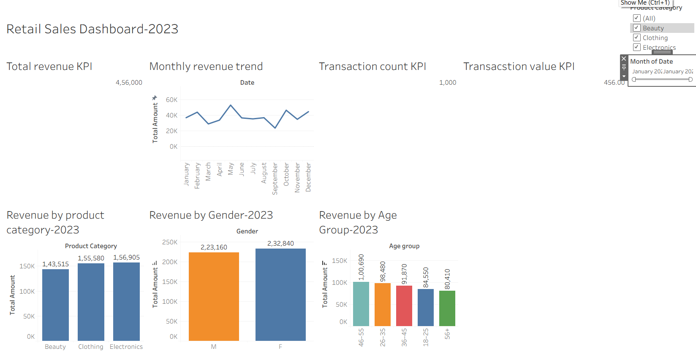

# Retail Sales Analysis Dashboard

## Project overview

This project analyzes retail sales performance using SQL and Tableau. The objective is to identify revenue trends, product-category performance, customer-segment patterns, and actions that can improve sales planning.

The final Tableau dashboard combines headline KPIs with monthly, category, gender, and age-group analysis in one interactive view.

## Tools used

- SQL for data exploration and aggregation
- Tableau Desktop for data visualization and dashboard creation
- GitHub for project documentation and version control

## Dataset

The dataset contains retail transaction records with fields including:

- Transaction ID
- Customer ID
- Date
- Gender
- Age
- Product Category
- Quantity
- Price per Unit
- Total Amount

## Business questions

This analysis answers the following questions:

1. What is the overall revenue, transaction count, and average transaction value?
2. How does revenue change by month?
3. Which product category generates the most revenue?
4. How does revenue differ by customer gender?
5. Which age group contributes the most revenue?

## Dashboard




The dashboard includes interactive filters for Product Category and Month of Date.

## Key performance indicators

| KPI | Result |
|---|---:|
| Total Revenue | 456,000 |
| Transaction Count | 1,000 |
| Average Transaction Value | 456.00 |

## Key insights

### Monthly revenue

- May was the highest-revenue month, generating 53,150.
- September was the lowest-revenue month, generating 23,620.
- The monthly trend shows a clear opportunity to plan inventory and campaigns around seasonal demand.

### Product category performance

| Product Category | Revenue |
|---|---:|
| Electronics | 156,905 |
| Clothing | 155,580 |
| Beauty | 143,515 |

Electronics generated the highest revenue, although Electronics and Clothing performed at very similar levels.

### Revenue by gender

| Gender | Revenue |
|---|---:|
| Female | 232,840 |
| Male | 223,160 |

Female customers generated 9,680 more revenue than male customers. The difference is modest, so both customer groups remain important audiences.

### Revenue by age group

| Age Group | Revenue |
|---|---:|
| 46–55 | 100,690 |
| 26–35 | 98,480 |
| 36–45 | 91,870 |
| 18–25 | 84,550 |
| 56+ | 80,410 |

Customers aged 46–55 contributed the most revenue.

## Recommendations

1. Increase inventory availability and campaign activity before May, the strongest revenue month.
2. Investigate the lower performance in September and test targeted promotional offers during that period.
3. Prioritize marketing experiments for customers aged 46–55, while maintaining campaigns for other high-value age groups.
4. Feature Electronics and Clothing prominently in promotional placements, bundles, and cross-sell strategies.
5. Use the dashboard filters to monitor whether category and monthly performance change across customer segments.

## Repository structure

```text
retail-sales-tableau-analysis1/
├── README.md
├── images/
│   └── retail-sales-dashboard.png
├── retail_sales.sqlproj
├── sql/
│   └── retail_sales_analysis.sql
└── tableau/
    └── retail_sales-2023.twbx
```

## How to use this project

1. Download or clone this repository.
2. Open `tableau/retail_sales-2023.twbx` in Tableau Desktop or Tableau Public.
3. Use the Product Category and Month filters to explore the dashboard.
4. Review the SQL file in `sql/` to see the analysis queries.

## Author

Gaurav Shekhar
